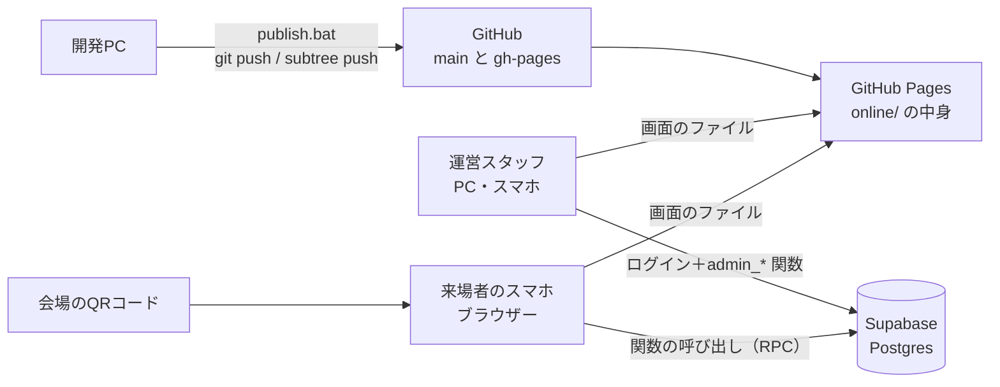
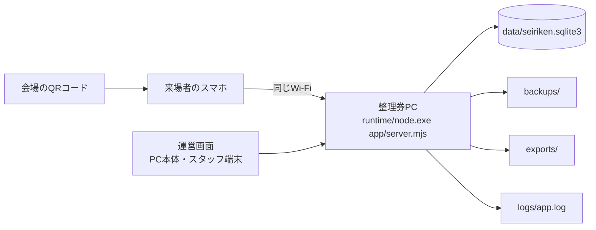

# 紅華祭 整理券アプリ プロジェクト説明

このファイルは、プロジェクト全体の「地図」です。
何のためのアプリで、どんな部品があり、どこで何が動いていて、どこを直せば何が変わるのかを、まとめて説明します。

- 当日の使い方（スタッフ・来場者向け）は `使い方説明書.md`
- Wi-Fi版の起動・停止・データの扱いは `最初に読む.txt`
- Supabase版の準備手順は `supabase/README.md`
- 開発の経緯と当初の要件は `計画書.md`

を見てください。このファイルは、それらを横断して「全体がどうつながっているか」を開発者・引き継ぐ人向けに説明するものです。

---

## もくじ

1. [このアプリは何か](#1-このアプリは何か)
2. [2つの版（Wi-Fi版とSupabase版）](#2-2つの版wi-fi版とsupabase版)
3. [全体の構成図](#3-全体の構成図)
4. [フォルダーとファイルの一覧](#4-フォルダーとファイルの一覧)
5. [整理券のルール（仕様）](#5-整理券のルール仕様)
6. [データの設計](#6-データの設計)
7. [Wi-Fi版のサーバー（API）](#7-wi-fi版のサーバーapi)
8. [Supabase版のデータベース関数](#8-supabase版のデータベース関数)
9. [画面のしくみ](#9-画面のしくみ)
10. [スマホに保存するもの](#10-スマホに保存するもの)
11. [セキュリティと不正対策](#11-セキュリティと不正対策)
12. [ビルドと公開](#12-ビルドと公開)
13. [テスト](#13-テスト)
14. [よくある変更の手順](#14-よくある変更の手順)
15. [変更の歴史](#15-変更の歴史)
16. [わかっている制約と注意点](#16-わかっている制約と注意点)
17. [用語集](#17-用語集)

---

## 1. このアプリは何か

紅華祭のステージ公演で、**回ごとの入場整理券をスマホで配る** Webアプリです。

- 来場者は会場に貼ったQRコードをスマホで読み、ブラウザーで整理券を取ります。アプリのインストールも会員登録もいりません。
- 公演は「10:00の回」「11:00の回」のように回に分かれていて、回ごとに定員があります。
- 整理券には「回・番号・代表者の名前・子どもと保護者の人数」が大きく出ます。入場口のスタッフは画面を目で見て確認するだけです（スキャンはしません）。
- 受付は回ごとの受付開始〜終了時刻のあいだだけ自動で行われ、満員になると自動で締め切ります。
- 運営スタッフは運営画面で、回の登録・一時停止・整理券の一覧と取消・集計・CSV出力・掲示用QRの印刷ができます。

想定規模は1日500〜3000枚程度、開催は1日だけです。

### 子どもの区分と保護者

申し込みでは、子どもの人数を **未就学児・小学生・中学生・高校生** の4区分で選びます。

- **定員と「1枚あたりの上限」は、子どもの人数だけで数えます。**
- 未就学児か小学生が1人以上いるときだけ、付きそいの **保護者の人数（0〜10名）** を入れられます。保護者は定員に数えません。
- 中学生・高校生だけのときは、保護者は0名として記録されます（送られてきても無視します）。

### 代表者の名前

申し込みには **代表者の名前（前後の空白を除いて1〜30文字）が必須** です。整理券の画面、運営画面の一覧、CSVに出ます。

---

## 2. 2つの版（Wi-Fi版とSupabase版）

画面のソースは1つで、ビルドのしかたによって2種類のアプリができます。整理券のルールはどちらもまったく同じです。

| | Wi-Fi版（持ち運び版） | Supabase版（オンライン版） |
|---|---|---|
| データの置き場所 | 整理券PCの SQLite（`data/seiriken.sqlite3`） | Supabase（インターネット上の Postgres） |
| 来場者のつなぎ方 | 整理券PCと同じWi-Fi（モバイルルーター推奨） | インターネットにつながれば何でもよい（4G/5G可） |
| 来場者用URL | `http://192.168.x.x:8766/` など（PCのLANアドレス） | https://makosana.github.io/koukasai_seiriken/ |
| 運営画面 | 上のURLの `#/admin` | https://makosana.github.io/koukasai_seiriken/#/admin |
| 整理券のルールを実装している場所 | `source/backend/lib/seiriken-service.mjs`（JavaScript） | `supabase/migrations/*.sql` の関数（PL/pgSQL） |
| 運営スタッフの認証 | PC本体は不要。他の端末は8桁のスタッフコード | Supabase Auth のメールアドレスとパスワード |
| CSV | サーバーが作り、`exports/` にも保存 | ブラウザーの中で作ってダウンロード |
| バックアップ | 自動（`backups/`） | Supabase 側に保存。終了後にCSVで手元に残す |
| ビルド結果 | `app/public/` | `online/` |
| 公開 | 不要（PCで起動するだけ） | GitHub Pages（`publish.bat`） |

**今のメインは Supabase版** です。Wi-Fi版は、インターネットが使えないときの予備として残してあります。2つの版のデータはつながっていないので、当日はどちらか一方だけを使います。

---

## 3. 全体の構成図

### Supabase版



- GitHub Pages は **画面（HTML・JavaScript・CSS）を配るだけ** です。データは持ちません。
- データの読み書きは、すべて Supabase のデータベース関数を通します。表を直接読むことはできません。

### Wi-Fi版



- 整理券PCの中で、同梱の Node.js がWebサーバーとして動きます。画面もAPIも同じサーバーが返します。
- インターネットは不要です。

### 画面から見たデータの流れ

```mermaid
flowchart TB
  UI[visitor.tsx / admin.tsx] --> B[lib/backend.ts<br/>backend&#40;&#41;]
  B -->|ビルドモードが local| L[localBackend<br/>fetch /api/...]
  B -->|ビルドモードが online| S[lib/backend-supabase.ts<br/>supabase.rpc&#40;...&#41;]
  L --> Node[Wi-Fi版サーバー]
  S --> PG[Supabase の関数]
```



画面のコードは `backend()` だけを呼び、どちらの版かを意識しません。

---

## 4. フォルダーとファイルの一覧

```
koukasai_seiriken/
├─ 使い方説明書.md          当日の使い方（スタッフ・来場者向け、やさしい文章）
├─ プロジェクト説明.md      このファイル
├─ 計画書.md                当初の要件と設計メモ
├─ 最初に読む.txt           Wi-Fi版の起動・停止・データの扱い
├─ 起動.bat                 Wi-Fi版を「このPCだけ」で起動（準備用）
├─ 来場者受付用に起動.bat   Wi-Fi版を同じWi-Fiのスマホに公開して起動（本番用）
├─ 停止.bat                 Wi-Fi版を安全に停止（停止時にバックアップ）
├─ オンライン版を試す.bat   Supabase版の画面をこのPCで試す（http://127.0.0.1:8767）
├─ publish.bat              Supabase版をビルドして GitHub Pages に公開
├─ .gitignore
├─ .cursor/rules/           Cursor のAIへの指示（説明書を毎回更新するルール）
│
├─ app/                     Wi-Fi版の実行用ファイル（source からビルドして作る。直接編集しない）
│   ├─ server.mjs, storage.mjs, control.mjs, schema.sql
│   ├─ lib/seiriken-service.mjs
│   ├─ migrations/002_children.sql, 003_name.sql
│   └─ public/              ビルド済みの画面
│
├─ online/                  Supabase版の画面（ビルドして作る。これが GitHub Pages に載る）
│   ├─ index.html, favicon.svg, .nojekyll
│   └─ assets/
│
├─ supabase/
│   ├─ README.md            Supabase版の準備手順
│   └─ migrations/
│       ├─ 001_init.sql     表・RLS・トリガー・関数（最初に1回）
│       ├─ 002_children.sql 子どもの区分と保護者（2番目に1回）
│       └─ 003_name.sql     代表者の名前（3番目に1回）
│
├─ source/                  ソースコード（直すのはここ）
│   ├─ package.json, tsconfig.json, vite.config.mjs, index.html
│   ├─ build-portable.mjs   Wi-Fi版のビルド（app/ を作る）
│   ├─ build-online.mjs     Supabase版のビルド（online/ を作る）
│   ├─ preview-online.mjs   online/ をこのPCで配る簡易サーバー
│   ├─ .env.online          Supabase の URL と公開鍵（Gitに入れない）
│   ├─ .env.online.example  上のひな形
│   ├─ README.md            ソースの説明
│   ├─ backend/             Wi-Fi版のサーバー
│   │   ├─ server.mjs       HTTPサーバー、認証、API の振り分け、静的ファイル
│   │   ├─ storage.mjs      SQLite を開く、マイグレーション、トランザクション、バックアップ
│   │   ├─ control.mjs      停止.bat から呼ばれる、安全な停止
│   │   ├─ schema.sql       DB定義 v1
│   │   ├─ migrations/      DB定義 v2（002_children.sql）、v3（003_name.sql）
│   │   └─ lib/seiriken-service.mjs   整理券のルール本体（発行・取消・状態の計算・CSV）
│   ├─ frontend/            画面（React + TypeScript）
│   │   ├─ main.tsx         画面の切り替え（ハッシュのURL）
│   │   ├─ visitor.tsx      来場者画面
│   │   ├─ admin.tsx        運営画面
│   │   ├─ ui.tsx           ダイアログとトースト（通知）
│   │   ├─ content.ts       来場者画面と掲示物の文言
│   │   ├─ globals.css      共通のデザイン（チケット会計アプリと共通）
│   │   ├─ seiriken.css     整理券アプリ固有のデザイン
│   │   └─ lib/
│   │       ├─ types.ts             型、区分の一覧、表示用の小さな関数
│   │       ├─ api.ts               Wi-Fi版の fetch、保存キーの scope、時刻表示
│   │       ├─ backend.ts           データの呼び出し口（版の切り替え）
│   │       └─ backend-supabase.ts  Supabase版の呼び出しとCSV作成
│   └─ tests/
│       ├─ seiriken-http.test.mjs   Wi-Fi版のテスト（HTTP経由、10件）
│       ├─ supabase-sql.test.mjs    Supabase版SQLのテスト（埋め込みPostgres、6件）
│       └─ online-smoke.mjs         本物のSupabaseに対する動作確認
│
├─ runtime/                 同梱の Node.js（node.exe）。Gitには入れない
├─ licenses/                同梱ライブラリーのライセンス
├─ data/                    Wi-Fi版のデータ（Gitに入れない）
├─ backups/                 Wi-Fi版の自動バックアップ（Gitに入れない）
├─ exports/                 Wi-Fi版のCSV出力（Gitに入れない）
└─ logs/                    Wi-Fi版のログ（Gitに入れない）
```

> `source/supabase-sql.test.mjs`（`tests/` の外にある空のファイル）は使われていません。消してもかまいません。

### 使っている技術

| 分類 | 技術 |
|---|---|
| 画面 | React 19、TypeScript 5.9、Vite 8、Tailwind CSS 4、lucide-react（アイコン）、qrcode（掲示用QR） |
| Wi-Fi版サーバー | Node.js 24 の標準機能だけ（`node:http`、`node:sqlite`、`node:crypto`）。外部ライブラリーなし |
| Supabase版 | Supabase（Postgres、Auth）、`@supabase/supabase-js` 2.118 |
| 公開 | GitHub Pages（`gh-pages` ブランチ） |
| テスト | `node:test`、`@electric-sql/pglite`（ブラウザーやNodeで動く小さなPostgres） |

---

## 5. 整理券のルール（仕様）

### 回の状態

回の状態は **保存せず、見るたびに計算** します。時刻で状態を書き換える定期処理がいらず、時計さえ合っていれば必ず正しい状態になります。

判定の順番（上が優先）:

| 状態 | 条件 |
|---|---|
| `finished` 終了した回 | 開演時刻 ＋ `finish_after_minutes` 分を過ぎた |
| `closed` 受付終了 | 受付終了時刻を過ぎた |
| `before` 受付前 | 受付開始時刻より前 |
| `paused` 一時停止中 | スタッフが一時停止している |
| `full` 満員 | 残り（定員 − 有効な整理券の子どもの合計）が0 |
| `open` 受付中 | 上のどれでもない |

- 時刻はすべて「開催日（`settings.event_date`）の日本時間」として扱います。回に日付は持たせません。
- 判定に使う「今の時刻」は、スマホではなく **サーバー（整理券PC／Supabase）の時刻** です。

### 発行（整理券を取る）

次の順に確認し、すべて通ったら発行します。

1. 名前・子どもの人数・保護者の人数・端末ID・送信番号の形式チェック
2. 回をロックする（Wi-Fi版は `BEGIN IMMEDIATE`、Supabase版は `SELECT ... FOR UPDATE`）。同じ回への申し込みは1件ずつ処理されます
3. 同じ送信番号（`request_id`）がすでにあれば、新しく発行せずに **前回の整理券をそのまま返す**（通信が切れて再送しても二重発行しない）
4. 回の状態が `open` か（受付前・一時停止・受付終了・満員なら断る）
5. 子どもの合計が「1枚の上限（`max_party`）」以下か
6. 子どもの合計が「残り」以下か
7. その端末が、この回の有効な整理券をまだ持っていないか（1端末1回1枚）
8. 番号 ＝ その回の最大番号 ＋ 1（取消された番号も含めて数えるので、**番号は再利用しない**）

### 取消

- **来場者本人**：整理券IDと取消用の合言葉（token）が合えば取り消せます。**開演時刻を過ぎると取り消せません**。
- **スタッフ**：運営画面から、開演後でもいつでも取り消せます。
- 取り消すと、その分の子どもの人数が残りに戻ります。取消の記録には「本人」か「スタッフ」かを残します。
- 取り消した整理券をもう一度取り消そうとしても、エラーにならず「すでに取消済み」として同じ結果を返します。

### 記録の保護

- 整理券は **削除できません**。変更できるのは「有効 → 取消」だけです（データベースのトリガーで強制）。
- 整理券を1枚でも発行した回は削除できません（受付を止めたいときは一時停止）。
- 運営操作の記録（`operations`）は変更も削除もできません。
- 定員は、すでに発行した子どもの人数より少なくできません。

### エラーコード

画面はエラーの「コード」を見て動きを変えます。両方の版で同じコードを返します。

| コード | 意味 |
|---|---|
| `invalid` | 入力の形式が正しくない |
| `not_found` | 回や整理券が見つからない |
| `before` / `paused` / `closed` / `full` | 回の状態により受け付けられない |
| `party` | 1枚の上限を超えた |
| `remaining` | 残りが足りない |
| `already` | この端末はこの回の整理券をすでに持っている |
| `request_conflict` | 同じ送信番号が別の端末から来た |
| `started` | 開演後なので本人は取り消せない |
| `forbidden` | 合言葉が合わない |
| `login` | 運営画面にログインが必要 |
| `throttled` | 操作が多すぎる（Wi-Fi版のみ） |

---

## 6. データの設計

### 表

| 表 | 内容 |
|---|---|
| `settings` | `event_date`（開催日）だけを持つ |
| `rounds`（回） | `id`, `label`（回の名前）, `starts_time`（開演）, `opens_time` / `closes_time`（受付時間）, `capacity_people`（定員＝子どもの人数）, `max_party`（1枚の子ども上限、1〜20）, `finish_after_minutes`（終了扱いまでの分、0〜600）, `paused`, `created_at`, `updated_at` |
| `tickets`（整理券） | 下の表 |
| `operations` | 運営操作の記録（回の作成・編集・一時停止・削除・開催日の変更・スタッフ取消） |

`tickets` の列:

| 列 | 内容 | 追加された版 |
|---|---|---|
| `id` | 整理券ID（UUID） | v1 |
| `round_id` | どの回か | v1 |
| `number` | 番号（回ごとに1から） | v1 |
| `party_size` | **子どもの合計**（定員と上限に数える） | v1 |
| `device_id` | 申し込んだ端末のID（ブラウザーごとのランダムなUUID） | v1 |
| `request_id` | 送信番号（再送しても二重発行しないため。一意） | v1 |
| `cancel_token` | 取消用の合言葉（本人確認に使う） | v1 |
| `status` | `active`（有効）／`cancelled`（取消） | v1 |
| `created_at` / `cancelled_at` | 発行時刻／取消時刻 | v1 |
| `cancelled_by` | `visitor`（本人）／`staff`（スタッフ） | v1 |
| `preschool` / `elementary` / `junior_high` / `high_school` | 区分ごとの子どもの人数（各0〜20） | v2 |
| `guardians` | 保護者の人数（0〜10、定員に数えない） | v2 |
| `name` | 代表者の名前（30文字まで。v2以前の整理券は空） | v3 |

制約:

- `(round_id, number)` は一意（番号の重複なし）
- 有効な整理券に限り `(round_id, device_id)` は一意（1端末1回1枚）
- `request_id` は一意

### DB定義の版（マイグレーション）

配布済み・運用中のデータを壊さないように、DB定義は **追加のファイルを番号順に足していく** 方式です。既存のファイルは書き換えません。

| 版 | Wi-Fi版 | Supabase版 | 内容 |
|---|---|---|---|
| v1 | `source/backend/schema.sql` | `supabase/migrations/001_init.sql` | 最初の定義 |
| v2 | `source/backend/migrations/002_children.sql` | `supabase/migrations/002_children.sql` | 子どもの区分・保護者 |
| v3 | `source/backend/migrations/003_name.sql` | `supabase/migrations/003_name.sql` | 代表者の名前 |

- **Wi-Fi版**：起動時に `storage.mjs` が自動で適用します。適用済みの版は `app_migrations` 表にファイルのハッシュ（SHA-256）と一緒に記録され、適用済みファイルの中身が変わっていたら **安全のため起動を止めます**。データの方が新しい版の場合も止まります。
- **Supabase版**：SQL Editor に貼り付けて、番号順に1回ずつ手で実行します。自動では適用されません。

新しい版を足すときは、`storage.mjs` の `migrations` 配列にも1行追加します。

---

## 7. Wi-Fi版のサーバー（API）

`source/backend/server.mjs`。ポートは **8766**（チケット会計アプリの8765と同時に使える）。

### 起動のしかた

| 起動方法 | 受け付ける相手 |
|---|---|
| `起動.bat`（`server.mjs --open`） | このPCだけ（127.0.0.1） |
| `来場者受付用に起動.bat`（`--lan --open`） | 同じWi-Fiのスマホも（0.0.0.0）。黒い画面に来場者用URLとスタッフコードが出る |
| `停止.bat`（`control.mjs`） | 起動中のサーバーに停止を依頼し、バックアップを取って終わる |

環境変数 `SEIRIKEN_PORT`（ポート）、`SEIRIKEN_DATA_DIR`（データの場所）、`SEIRIKEN_NO_BROWSER=1`（ブラウザーを開かない）で変えられます。

### 来場者用API

| メソッド・パス | 内容 |
|---|---|
| `GET /api/public/state` | 回の一覧（受付時間・状態・残り・定員・1枚の上限）とサーバーの現在時刻 |
| `POST /api/public/issue` | 整理券の発行。`{roundId, children:{preschool, elementary, junior_high, high_school}, guardians, name, deviceId, requestId}` |
| `POST /api/public/tickets` | 自分の整理券の最新状態。`{items:[{id, token}, ...]}`（30件まで）。合言葉が合わないものは `null` |
| `POST /api/public/request` | 送信番号で、発行済みかどうかを確認（通信が切れたとき用） |
| `POST /api/public/cancel` | 本人による取消。`{id, token}` |

### 運営用API

PC本体（127.0.0.1からの接続）は認証なし、他の端末はスタッフコードで発行された Cookie が必要です。

| メソッド・パス | 内容 |
|---|---|
| `POST /api/admin/login` | スタッフコードの確認（10分に10回まで） |
| `GET /api/admin/state` | 回ごとの集計・合計・サーバー情報（PC本体にだけスタッフコードとDBの場所を返す） |
| `GET /api/admin/tickets?round=&number=` | 回の整理券一覧（番号で絞り込み可） |
| `GET /api/admin/csv` | CSVを作って返し、`exports/` にも保存 |
| `POST /api/admin/operation` | `action` が `settings`（開催日）・`create`・`update`・`pause`・`resume`・`delete` |
| `POST /api/admin/cancel` | スタッフによる取消 |
| `POST /api/admin/backup` | すぐにバックアップを作る |

### その他

- `/runtime-config.js`：画面に、このインストール固有のID（スマホの保存キーに使う）を渡す
- `/healthz`、`/_local/stop`：PC本体からだけ使える、起動確認と停止用
- POST の API は `X-Seiriken-Request: 1` と `Content-Type: application/json` が必須（他のサイトから勝手に送らせないため）
- 発行は同じIPから1分に30回まで

### バックアップ

`backups/` に SQLite ファイルのコピーを作ります。タイミングは、起動時・20件の変更ごと・変更があれば5分ごと・停止時・運営画面から手動、です。

---

## 8. Supabase版のデータベース関数

### 守り方の基本

- すべての表で **RLS（行レベルセキュリティ）を有効にし、ポリシーを1つも作らない**。つまり、公開鍵（publishable key）を使っても表を直接読み書きできません。
- 読み書きはすべて `SECURITY DEFINER` の関数を通します。関数の中だけが表にさわれます。
- 補助の関数は `private` スキーマに置き、外からは呼べません。
- 運営用の関数は最初に `private.require_staff()` でログイン済みかを確かめます。**ログインできる人は全員スタッフ扱い** なので、Supabase の「新規登録（Sign up）」は必ず無効にしておきます。
- エラーは `hint` にエラーコード（`full` など）を入れて返し、画面は Wi-Fi版と同じ扱いをします。

### 呼べる関数

| 関数 | 呼べる人 | 内容 |
|---|---|---|
| `public_state()` | 誰でも | 回の一覧と現在時刻 |
| `issue_ticket(p_round_id, p_children jsonb, p_guardians, p_name, p_device_id, p_request_id)` | 誰でも | 発行（v3 の形） |
| `lookup_tickets(p_items jsonb)` | 誰でも | 自分の整理券の最新状態（30件まで） |
| `find_request(p_request_id, p_device_id)` | 誰でも | 送信番号で発行済みか確認 |
| `cancel_ticket(p_id, p_token)` | 誰でも | 本人による取消 |
| `admin_state()` | スタッフ | 回ごとの集計と合計 |
| `admin_operation(p jsonb)` | スタッフ | 開催日・回の作成・編集・一時停止・再開・削除 |
| `admin_list_tickets(p_round_id, p_number)` | スタッフ | 整理券の一覧 |
| `admin_cancel(p_id)` | スタッフ | スタッフによる取消 |
| `admin_export_tickets()` | スタッフ | CSV用の全件データ |

`issue_ticket` は版を重ねるごとに引数が増えたので、古い形は `drop function` で消してから新しい形を作っています。そのため、**SQLを実行したら、すぐに新しい画面を公開する** 必要があります（古い画面は古い形の関数を呼ぶので、整理券を取れなくなります）。

### 接続設定

`source/.env.online`（Gitに入れない）:

```
VITE_SUPABASE_URL=https://svgnbbbmsneeimxxufkx.supabase.co
VITE_SUPABASE_ANON_KEY=sb_publishable_...
```

この鍵は来場者のスマホにも届く「公開してよい鍵」です。**service_role key（secret key）は絶対に書かない** でください。書くと誰でも全データを読み書きできてしまいます。

---

## 9. 画面のしくみ

画面は1ページのアプリで、URLの `#` 以降で切り替えます（`main.tsx`）。

| URL | 画面 |
|---|---|
| `#/` | 来場者のトップ（注意事項と回の一覧） |
| `#/ticket` | 自分の整理券 |
| `#/t/<整理券ID>/<合言葉>` | 整理券のリンク。開くとその整理券をこのブラウザーに取り込み、`#/ticket` に切り替わる |
| `#/admin` | 運営画面 |

### 来場者画面（`visitor.tsx`）

- **トップ**：注意事項（`content.ts`）、回のカード（状態・受付時間・残り）。受付中の回には「整理券を取る」、すでに持っている回には「整理券を見る（No.○）」が出ます。持っている整理券があると「整理券を ○ 枚お持ちです」の帯が出ます。
- **申し込みダイアログ**：名前の入力欄、4区分の人数（＋−ボタン）、未就学児・小学生がいるときだけ保護者の人数。子どもの合計が「1枚の上限」と「残り」の小さい方に達すると、それ以上増やせません。名前が空だと送信できません。名前は次回のために保存され、最初から入力されます。
- **整理券の画面**：回の名前・開演時刻・大きな番号・「○○ 様」・「子ども ○ 名＋保護者 ○ 名」・区分の内訳・秒まで動く時計・光るアニメーション。回ごとに色が変わります（`tone-0`〜`tone-5`）。スクリーンショットの使い回しを見分けやすくするためです。
- **取消**：開演前なら「この整理券を取り消す」から取り消せます。
- **整理券のリンク**：「整理券のリンクを保存（別のブラウザー用）」で、リンクのコピー・共有ができます。
- **通信が途中で切れたとき**：送信内容を「確認待ち」として保存しておき、「結果を確認する」ボタンで、発行済みかどうかを送信番号で確かめます。何度押しても二重には発行されません。
- **更新**：10秒ごと（画面が見えているときだけ）と、画面に戻ってきたときに、回と整理券を最新にします。

### 運営画面（`admin.tsx`）

左のメニューに4つの画面があります。5秒ごとに自動で最新になります。

| 画面 | できること |
|---|---|
| 回の管理 | 開催日の設定、回の追加・編集・一時停止・再開・削除、回ごとの状態と発行数 |
| 整理券の一覧 | 回を選んで一覧（番号・名前・子ども・保護者・状態・発行時刻・端末）、番号で照合、スタッフ取消 |
| 集計・出力 | 合計（発行枚数・子ども・保護者・取消・残り）、回ごとの表、CSV出力、（Wi-Fi版のみ）手動バックアップ |
| 掲示用QR | 来場者用URLのQRコードを印刷用に表示。Wi-Fi版はWi-Fi接続用のQRも一緒に載せられる |

- Wi-Fi版は、PC本体ではそのまま入れ、他の端末ではスタッフコードを入力します。
- Supabase版は、メールアドレスとパスワードでログインします。
- 開催日が今日でないときは、上に黄色いお知らせが出ます。

### 文言を変えたいとき

来場者画面と掲示物の文言は `source/frontend/content.ts` にまとめてあります（イベント名・公演名・説明文・注意事項・フッター・掲示物の見出し）。

---

## 10. スマホに保存するもの

ブラウザーの localStorage に保存します。キーの `<scope>` は、Wi-Fi版ではインストールごとのID、Supabase版では `online-<SupabaseのプロジェクトID>` です（別の環境のデータと混ざらないように）。

| キー | 中身 |
|---|---|
| `seiriken-<scope>-device-v1` | 端末ID（初回にランダムに作る。1端末1回1枚の判定に使う） |
| `seiriken-<scope>-tickets-v1` | 持っている整理券の一覧。`{id, token, ticket}`。`ticket` は最後に確認した整理券の中身 |
| `seiriken-<scope>-pending-v1` | 確認待ちの申し込み（送信番号・回・人数・名前） |
| `seiriken-<scope>-name-v1` | 前回入力した名前 |

### 表示のしかた

1. ページを開いたら、まず保存してある整理券の中身をすぐに表示します（電波が弱くても見える）。
2. 裏でサーバーに最新の状態を問い合わせ、結果で置きかえます。サーバーに存在しない（合言葉が合わない・記録が消された）整理券は、一覧から外します。
3. 問い合わせに失敗したら、表示はそのままにして「前回確認した内容を表示しています」と出します。

### 別のブラウザーでは見えない問題

localStorage はブラウザーごとに別なので、QRを読むアプリが変わる（例: カメラ→Safari、LINEのQRリーダー→LINEの中のブラウザー）と整理券が見えません。対策として、

- 整理券のリンク（`#/t/<id>/<token>`）を保存しておけば、どのブラウザーでも取り込めます。
- 運営画面の「整理券の一覧」で名前から探して確認できます。

---

## 11. セキュリティと不正対策

| 心配ごと | 対策 |
|---|---|
| 同時の申し込みで定員を超える・番号が重複する | 回ごとにロックして1件ずつ採番。テストで同時400件（Wi-Fi版）を確認 |
| 通信が切れて再送し、二重に発行される | 送信番号（`request_id`）が同じなら前回の整理券を返す |
| 1人が何枚も取る | 1端末（ブラウザー）1回1枚。シークレットモードや別のブラウザーではすり抜けられるが、方針として許容し、スタッフ取消で対処 |
| スクリーンショットの使い回し | 秒まで動く時計と光るアニメーション、回ごとの色、運営画面での番号・名前の照合 |
| 他人の整理券を見る・取り消す | 整理券IDと合言葉（ランダムな長い文字列）の両方が必要 |
| 来場者が全員の整理券を見る | Wi-Fi版は運営APIに認証、Supabase版はRLSで表を直接読めない |
| 運営画面への不正ログイン | Wi-Fi版はスタッフコード（10分に10回まで）、Supabase版は新規登録を無効にする |
| CSVをExcelで開いたときの数式の注入 | `=` `+` `-` `@` などで始まるセルの先頭に `'` を付ける |
| 名前の入力に改行などの制御文字 | サーバー側で拒否 |
| 他のサイトからAPIを勝手に呼ばせる（Wi-Fi版） | 独自ヘッダー必須、Origin の確認、Cookie は `SameSite=Strict` |
| 時刻のずれ | 判定はサーバーの時刻。スマホの時計は表示の目安だけ |
| 記録の改ざん | 整理券の削除・取消以外の変更をトリガーで禁止。操作記録も変更不可 |

### 個人情報

v3 から代表者の名前を保存しています。

- 来場者が見られるのは、合言葉を知っている自分の整理券だけです。
- 名前の一覧を見られるのはスタッフだけです（運営画面・CSV）。
- 終わったらCSVの扱いに気をつけ、不要になったデータは消してください（`使い方説明書.md` 10章の「データを全部消す」）。

---

## 12. ビルドと公開

### 開発環境

このPCには、以前のビルドで用意した一時フォルダーがあります。

- `%TEMP%\seiriken-build\node-v24.22.0-win-x64`：Node.js 24（npm付き）
- `%TEMP%\seiriken-build\source`：`source` のコピーと `node_modules`

プロジェクトがネットワークドライブ（Z:）にあり `npm install` がとても遅いので、`source` をローカルにコピーしてビルドし、出力先だけ環境変数 `SEIRIKEN_OUTPUT` でプロジェクトに向けます。

```powershell
$t="$env:TEMP\seiriken-build"
$proj="Z:\開発課題\紅華-20260914T000958Z-1-001\koukasai_seiriken"
robocopy "$proj\source" "$t\source" /E /XD node_modules
$env:Path="$t\node-v24.22.0-win-x64;$env:Path"
cd "$t\source"
npx tsc -p tsconfig.json                  # 型検査
$env:SEIRIKEN_OUTPUT=$proj
node build-portable.mjs                   # Wi-Fi版 → app/
node build-online.mjs                     # Supabase版 → online/
```

別のPCで一から用意する場合は、Node.js 24 を入れて `source` で `npm install` してから、`npm run build` / `npm run build:online` を実行します。

### Wi-Fi版のビルド（`build-portable.mjs`）

- `backend/` のファイルを `app/` にコピー（`server.mjs`、`storage.mjs`、`control.mjs`、`schema.sql`、`lib/`、`migrations/`）
- 画面を `app/public/` にビルド
- Supabase のライブラリーは入りません

### Supabase版のビルド（`build-online.mjs`）

- `.env.online` を読み、画面を `online/` にビルド（`--mode online`）
- どのURLの下に置いても動くよう、ファイルの参照を相対パスにする
- `.nojekyll` を置く（GitHub Pages が `_` で始まるファイルを無視しないように）

### 公開（`publish.bat`）

ダブルクリックすると、次を順に行います。

1. このPCにビルド環境と `.env.online` があれば、`online/` を作り直す（なければ今の `online/` をそのまま使う）
2. `git add -A` → 変更があれば `git commit -m "更新 日付 時刻"`
3. `git push`（`main` ブランチ）
4. `git subtree push --prefix online origin gh-pages`（`online/` の中身だけを `gh-pages` ブランチへ）

1〜2分で https://makosana.github.io/koukasai_seiriken/ に反映されます。初回は GitHub のログインが求められます。

GitHub リポジトリ: https://github.com/Makosana/koukasai_seiriken

### Supabase のSQLを足したときの公開手順

1. Supabase の SQL Editor で、新しい番号のファイルを実行する
2. すぐに `publish.bat` を実行する

受付をしていない時間に、続けて行ってください。

---

## 13. テスト

| テスト | 実行方法 | 内容 |
|---|---|---|
| Wi-Fi版 | `source` で `..\runtime\node.exe --disable-warning=ExperimentalWarning --test tests/seiriken-http.test.mjs` | 起動・DB自動作成・全画面ファイル、状態の計算、定員・上限・1端末1枚・再送、区分と保護者、名前の検証、CSVの列と数式対策、v1からv3への移行、取消、同時400件、運営操作の検証、再起動後の保持・CSV保存・バックアップ、LAN経由のスタッフコード（10件） |
| Supabase版SQL | ビルド環境の `source` で `node --test tests/supabase-sql.test.mjs`（`../supabase/migrations` が必要） | 埋め込みPostgres（PGlite）で 001→002→003 を実行し、権限、状態の判定、定員・再送・1端末1枚、区分・保護者・名前、取消、運営操作の検証、記録の保護を確認（6件） |
| 本物のSupabase | `SEIRIKEN_STAFF_EMAIL` と `SEIRIKEN_STAFF_PASSWORD` を設定して `..\runtime\node.exe tests\online-smoke.mjs` | 発行・再送・1端末1枚・取消・200件同時。「自動確認」という回を作って最後に一時停止する（発行した回は消せないので残る） |
| 型検査 | `npx tsc -p tsconfig.json` | TypeScript の型 |

テスト用のデータは一時フォルダーに作られ、本番の `data/` は変わりません。

---

## 14. よくある変更の手順

### 来場者画面の文言を変える

1. `source/frontend/content.ts` を書き換える
2. `publish.bat`（Supabase版）／ビルドして `app/` を更新（Wi-Fi版）

### 申し込みの項目を増やす（例: 名前を足したときと同じ流れ）

1. **DB**：Wi-Fi版 `source/backend/migrations/00N_xxx.sql` と Supabase版 `supabase/migrations/00N_xxx.sql` を新しく作る（既存のファイルは書き換えない）。列の追加、取消以外の変更を禁止するトリガーの更新、Supabase版は `issue_ticket` の作り直しと権限の付け直し
2. **Wi-Fi版の登録**：`source/backend/storage.mjs` の `migrations` 配列に追加
3. **ルール**：`source/backend/lib/seiriken-service.mjs`（入力チェック、INSERT、`ticketView`、CSV）
4. **画面の型**：`source/frontend/lib/types.ts`（`Ticket`）、`lib/backend.ts`（`IssueInput`）
5. **Supabase版の呼び出し**：`lib/backend-supabase.ts`（`rpc` の引数、CSV）
6. **画面**：`visitor.tsx`（入力欄・表示）、`admin.tsx`（一覧）、`seiriken.css`
7. **テスト**：`tests/seiriken-http.test.mjs`、`tests/supabase-sql.test.mjs`、`tests/online-smoke.mjs`
8. **説明書**：`使い方説明書.md`、`supabase/README.md`、このファイル
9. 型検査・両方のビルド・両方のテスト
10. Supabase で新しいSQLを実行 → すぐに `publish.bat`

### 回の項目の上限を変える（例: 定員の最大値）

Wi-Fi版は `seiriken-service.mjs` の `LIMITS` と `schema.sql` の `CHECK`、Supabase版は `admin_operation` の中の範囲チェックと表の `CHECK`。表の `CHECK` を変えるには新しいマイグレーションが必要です。

### データを全部消す（リハーサルのあとなど）

- Supabase版：SQL Editor で `truncate public.tickets, public.operations, public.rounds restart identity;`（整理券だけなら `truncate public.tickets;`）。Table Editor からは削除できません（トリガーで禁止しているため）
- Wi-Fi版：アプリを止めて `data/` フォルダーを別名に変える（次の起動で新しく作られる）

---

## 15. 変更の歴史

| 時期 | 内容 |
|---|---|
| 最初 | `koukasai_ticket`（チケット会計アプリ）の構成を雛形に、Wi-Fi版を作成。回・定員・人数・受付時間・取消・集計・CSV・掲示用QR・自動バックアップ |
| その後 | 同じ画面のまま Supabase をデータの置き場所にする Supabase版を追加。`backend.ts` で版を切り替え。GitHub Pages で公開、`publish.bat` を作成 |
| 説明書 | `使い方説明書.md` を作成 |
| v2 | 子どもの区分（未就学児・小学生・中学生・高校生）と保護者の人数。定員と1枚の上限は子どもだけで数える |
| v3 | 代表者の名前（必須）。整理券・運営画面の一覧・CSVに表示 |
| 画面の改善 | 整理券の中身をスマホに保存してすぐ表示、通信失敗時の表示、整理券のリンク（別のブラウザーで復元） |
| ルール | `.cursor/rules/manual-update.mdc`：アプリを変えたら説明書も更新する |

---

## 16. わかっている制約と注意点

- **1端末1枚は簡易的な制限** です。シークレットモードや別のブラウザーを使えば、同じ人がもう1枚取れます。
- **Supabase の無料プランは、1週間使わないと一時停止** されます。本番の数日前と前日に管理画面を開いて確認してください。
- **SQLの実行と画面の公開はセット** です。片方だけだと整理券を取れない時間ができます。
- **Wi-Fi版は学校や会場のWi-Fiでは動かないことが多い** です（端末同士の通信が禁止されているため）。モバイルルーターを使います。
- **Wi-Fi版とSupabase版のデータはつながっていません**。
- **整理券のリンクを他人に渡すと、その人も整理券を表示・取消できます**。
- **ネットワークドライブ上で `npm install` は遅い** ので、ローカルにコピーしてビルドします。
- `計画書.md` には、作った当初の考え（Supabase版を作る前のメモなど）も残っています。今の動きと違うところは、このファイルと `使い方説明書.md` を正としてください。
- `使い方説明書.html` / `.pdf` は Markdown から書き出したもので、自動では更新されません。

---

## 17. 用語集

| 用語 | 意味 |
|---|---|
| 回 | 公演の1回分（例: 10:00の回）。定員と受付時間を持つ |
| 定員 | その回に入れる子どもの人数 |
| 1枚の上限（`max_party`） | 1枚の整理券で申し込める子どもの人数の上限 |
| 開催日（`event_date`） | 回の時刻をどの日付として扱うか。リハーサルでは今日にする |
| 終了扱い（`finish_after_minutes`） | 開演から何分たったら「終了した回」として薄く表示するか |
| 端末ID（`device_id`） | ブラウザーごとに作るランダムなID。1端末1回1枚の判定に使う |
| 送信番号（`request_id`） | 申し込み1回ごとのID。再送しても二重発行しないために使う |
| 合言葉（`cancel_token`） | 整理券ごとのランダムな文字列。本人の表示・取消に必要 |
| 整理券のリンク | `#/t/<整理券ID>/<合言葉>` の形のURL。別のブラウザーで整理券を取り込める |
| RLS | Row Level Security。Supabase（Postgres）の、表への直接アクセスを制限するしくみ |
| RPC | 画面から Supabase のデータベース関数を呼び出すこと |
| マイグレーション | DB定義を版ごとに少しずつ足していくSQLファイル |
| スタッフコード | Wi-Fi版で、PC以外の端末から運営画面に入るための8桁の数字 |
| publishable key / anon key | Supabase の公開してよい鍵。画面に埋め込まれる |
| service_role key / secret key | Supabase の全権限の鍵。**画面やGitに絶対に入れない** |
