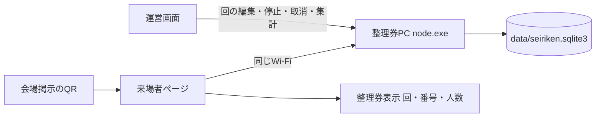

# 紅華祭 整理券アプリ 計画書

`koukasai_ticket` の構成（Vite + React + TypeScript + Tailwind の画面、同梱の Node.js で動くローカルサーバー）を雛形にして、来場者が会場のQRコードからスマホで公演の整理券を取れるWebアプリを `koukasai_seiriken` に作る。

> 2026-10-26 変更：GitHub Pages と Supabase で公開する案をやめ、整理券PC 1台で完結するローカル実行に変更した。データは整理券PC内の SQLite に置き、来場者のスマホは同じWi-Fiから接続する。
>
> 2026-10-26 追加：会場のWi-Fiに頼らずに済むよう、同じ画面のまま Supabase をデータの置き場所にする「Supabase版」を追加した。Wi-Fi版はそのまま残し、どちらを使うかはビルドで選ぶ（下の「Wi-Fi版とSupabase版」）。

## 決まったこと（要件）

- 用途: 1つの企画（公演）の、定員がある回ごとの入場整理（例: 10:00の回、11:00の回）
- 配り方: 当日、会場に貼ったQRコードを来場者がスマホで読み、その場で整理券を取る
- 整理券: スマホ画面に「何時の回・何番・何名」を大きく表示する。1枚で複数人まで入れる（人数を選ぶ）
- 入場確認: スタッフが画面の番号を目で見るだけ（スキャンはしない）
- 呼び出し表示: なし（整理券に回と番号が出れば十分）
- 不正対策: ログインはなし。ブラウザ1つにつき、1つの回で有効な整理券は1枚までという簡易的な制限にする（10時の回と11時の回を両方取ることはできる）
- 定員: 人数で数える（例: 定員100人の回で「3名」の整理券を出すと残りが3人減る）
- 配布の開始と終了: 回ごとに受付開始時刻と受付終了時刻を決めておき、その時間だけ自動で受け付ける。満員になれば時間内でも自動で締め切る。スタッフが手動で一時停止することもできる
- 開催: 1日だけ（回に日付の区別は持たせない）
- 公演後の整理券: 開演時刻を過ぎたら取消できなくする。開演から一定時間（初期値30分、回ごとに変更可）たった回は「終了した回」として薄く表示する
- 来場者画面の文言: 注意事項（集合場所、集合時刻、遅れた場合の扱いなど）を載せる。文言はコード内の設定ファイル（`src/content.ts`）に書き、運営画面からは編集しない
- 運営スタッフ: 整理券PC本体ではログイン不要。他の端末からは8桁のスタッフコード（全員共通）で入る。取消の記録は「本人が取り消した」か「スタッフが取り消した」かの区別だけを残す
- 規模: 1日500〜3000枚程度
- 運営画面: 回と定員・受付時間の登録・編集、手動での一時停止と再開、取消（来場者本人とスタッフの両方から）、集計とCSV出力
- 期限: 本番まで1か月以内
- 開発環境: 実行には何もインストールしない（`runtime/node.exe` を同梱）。画面を作り直すときだけ Node.js（npm 付き）を使う

## 構成

- 実行: 整理券PCで `runtime/node.exe app/server.mjs` を動かす。「起動.bat」は準備用（PCからのみ）、「来場者受付用に起動.bat」は本番用（同じWi-Fiのスマホに公開）。ポートは 8766（チケット会計の 8765 と同時に使える）
- データ: 整理券PC内の SQLite（`data/seiriken.sqlite3`）。番号の採番はトランザクションの中でまとめて行い、同時に申し込みが来ても番号の重複や定員超えが起きないようにする
- 雛形 `koukasai_ticket` から流用するもの: フォルダー構成、`runtime/` の同梱、`node:http` と `node:sqlite` のサーバー、起動・停止スクリプト、自動バックアップ、Vite・React 19・TypeScript・Tailwind 4・lucide-react の構成、`globals.css` の見た目、再送しても二重登録にならない request_id の考え方、8桁コードによる他端末の認証（運営画面のみに使う）
- フォルダー構成:

```
koukasai_seiriken/
  起動.bat / 来場者受付用に起動.bat / 停止.bat / オンライン版を試す.bat / 最初に読む.txt
  app/        実行用（server.mjs, storage.mjs, control.mjs, schema.sql, lib/, public/）
  runtime/    同梱の Node.js
  source/     ソース（backend/, frontend/, tests/, build-portable.mjs, build-online.mjs, preview-online.mjs）
  supabase/   Supabase版のDB定義（migrations/001_init.sql, 002_children.sql, 003_name.sql）と準備手順（README.md）
  online/     Supabase版の画面（npm run build:online で作る静的ファイル）
  data/ backups/ exports/ logs/ licenses/
```



## データ設計（`source/backend/schema.sql`）

- `settings`: `event_date`（開催日。回の時刻はこの日付の日本時間として扱う）
- `rounds`（回）: `id`, `label`, `starts_time`（公演の開始時刻）, `opens_time` / `closes_time`（受付時間）, `capacity_people`（定員の人数）, `max_party`（1枚で入れる最大人数。例: 4）, `finish_after_minutes`（開演から何分で「終了した回」にするか。初期値30）, `paused`（スタッフによる手動の一時停止）。並び順は開演時刻順
  - 「受付前 / 受付中 / 満員 / 受付終了 / 一時停止」の状態は保存せず、現在時刻・残り人数・`paused` から毎回計算する。時刻で状態を書き換える定期処理が不要になる
- `tickets`（整理券）: `id`(uuid), `round_id`, `number`, `party_size`, `device_id`, `request_id`, `cancel_token`, `status`（有効 / 取消）, `created_at`, `cancelled_at`, `cancelled_by`
  - 同じ回で番号が重複しないよう、`round_id` と `number` の組み合わせを一意にする
  - 同じ端末が同じ回で有効な整理券を2枚持てないよう、有効な整理券に限って `round_id` と `device_id` の組み合わせを一意にする
  - `request_id` も一意にし、通信が途切れて再送されても二重に発行しないようにする
- `operations`: 運営操作（回の追加・編集・一時停止・スタッフ取消など）の記録
- トリガー: 整理券の削除と、取消以外の書き換えを拒否する。整理券を発行した回は削除できない
- API（`source/backend/server.mjs`）
  - `POST /api/public/issue`（roundId, children{preschool, elementary, junior_high, high_school}, guardians, name, deviceId, requestId）: name（代表者の名前、前後の空白を除いて1〜30文字・必須）を記録する。子どもの合計を party_size として定員・1枚の上限に数え、保護者（guardians, 0〜10名）は未就学児・小学生がいるときだけ記録して定員には数えない。トランザクションの中で、受付時間内か、一時停止中でないか、残りの人数が足りるか、その端末がこの回の有効な整理券をまだ持っていないかを確認する。番号は「その回の最大番号＋1」（取り消された番号は再利用しない）
  - `POST /api/public/tickets` / `POST /api/public/cancel`（id, token）: 本人だけが自分の整理券を見たり取り消したりできる。開演時刻を過ぎた回の整理券は取り消せない
  - `POST /api/public/request`: 通信が途切れたとき、送信番号で発行済みかどうかを確かめる
  - `GET /api/public/state`: 来場者向けに、回ごとの受付時間・状態・残り人数だけを見せる
  - `cancelled_by` には `visitor`（本人）か `staff`（運営画面）のどちらかを記録する
- アクセス制限: 来場者は `tickets` の一覧を見られない。運営API（`/api/admin/*`）は整理券PC本体か、スタッフコードで入った端末だけが使える

## 画面（`source/frontend/` 配下。ハッシュ形式のルーティング）

- 来場者向け
  - `/#/`: 注意事項と、回の一覧（受付時間、状態、残り人数）。終了した回は薄く表示する。受付中の回と人数を選んで「整理券を取る」を押す。すでに整理券を持っている回には「整理券を見る」を出す
  - `/#/ticket`: 持っている整理券の一覧と表示（回・番号・人数を大きく）。画面のスクショで偽造されにくいよう、現在時刻を動かして表示し、回ごとに色を変える。取消ボタンも置く
  - 整理券の id と cancel_token は localStorage に保存しておき、ページを開き直しても表示されるようにする（回ごとに1枚なので、複数枚を保存できるようにする）
- 運営向け（`/#/admin`、整理券PC本体ではそのまま、他の端末ではスタッフコードで入る）
  - 回の登録・編集（定員、1枚あたりの最大人数、受付開始・終了時刻）と、手動での一時停止・再開
  - 回ごとの整理券一覧（番号で検索できるようにし、入場口で疑わしい券を照合できるようにする）と取消
  - 集計（配布枚数・人数、残り人数）と CSV 出力
  - 会場に貼るQRコードの表示・印刷（Wi-Fi接続用のQRも一緒に載せられる）
  - 開催日の設定（リハーサル時は今日にする）

## Wi-Fi版とSupabase版

画面（`source/frontend/`）は1つで、ビルドのしかたで2種類を作り分ける。整理券のルールはどちらも同じ。

| | Wi-Fi版 | Supabase版 |
|---|---|---|
| ビルド | `npm run build` → `app/public/` | `npm run build:online` → `online/` |
| データ | 整理券PCの SQLite | Supabase の Postgres |
| 来場者の接続 | 整理券PCと同じWi-Fi | インターネット（モバイル通信でも可） |
| 処理の場所 | `source/backend/lib/seiriken-service.mjs` | `supabase/migrations/001_init.sql` の関数（同じルールを PL/pgSQL で実装） |
| 運営の認証 | PC本体は不要、他の端末は8桁のスタッフコード | Supabase Auth（メールアドレスとパスワード）。新規登録は無効にする |
| CSV | サーバーが作り `exports/` にも保存 | ブラウザーで作ってダウンロード |
| バックアップ | 自動（`backups/`） | Supabase 側。終了後にCSVを残す |
| 掲示用QR | PCのLANアドレス＋Wi-Fi接続用QR | いま開いている公開URL |

- 画面からの呼び出しは `source/frontend/lib/backend.ts` にまとめた。Wi-Fi版は既存の `/api/...`、Supabase版は `backend-supabase.ts` から関数（RPC）を呼ぶ。Supabase のライブラリーは Supabase版のビルドにだけ入る
- Supabase版の守り方: 全ての表で RLS を有効にしてポリシーを作らない（＝表を直接読めない）。来場者は `public_state` / `issue_ticket` / `lookup_tickets` / `find_request` / `cancel_ticket` だけ、ログインしたスタッフは `admin_*` も呼べる。関数は SECURITY DEFINER で、発行時は回の行を `FOR UPDATE` でロックして1件ずつ採番する
- エラーは Wi-Fi版と同じコード（`full`, `already`, `started` など）を `hint` に入れて返し、画面の扱いを共通にした
- 確認: `npm run test:sql` で SQL を埋め込みの Postgres（PGlite）で検証（権限、状態の判定、定員、再送、1端末1枚、取消、運営操作の検証、記録の保護）。本物のプロジェクトでは `tests/online-smoke.mjs` で200件同時の申し込みまで確認する

## 主なリスクと対策

- 同時アクセスで定員を超える: 採番をトランザクションの中で行う。自動テストで400件を同時に送り、番号の重複と定員超えがないことを確認済み
- 1人で何枚も取る: 端末ごとの制限なので、シークレットモードを使えばすり抜けられる。これは今回の方針どおり許容する。ただし運営画面の取消で対処できるようにしておく
- スクショの使い回し: 動く時刻表示と、運営画面での番号照合で対処する
- 会場のWi-Fi: 学校や会場のWi-Fiは端末同士の通信を禁止していることが多い。整理券専用のモバイルルーターを用意し、本番前に会場でスマホからの接続を確認する
- 整理券PCが止まる: 充電器をつなぎ、スリープと自動再起動を止める。記録は1件ごとにSQLiteへ確定し、自動バックアップも取る
- Supabase版の停止: 無料プランは1週間使わないと一時停止される。本番の数日前と前日に管理画面を開いて確認する
- Supabase版の不正ログイン: ログインできる人は全員スタッフ扱いなので、新規登録（Sign up）を必ず無効にする。`online-smoke.mjs` でも確認する
- 時刻のずれ: 受付時間の判定はスマホではなく整理券PC（Supabase版は Supabase）の時刻で行う。画面に出す「受付開始まであと何分」は目安として扱う

## 作業項目

1. [済] 雛形と同じフォルダー構成で初期化（runtime 同梱、起動・停止スクリプト）
2. [済] SQLite のテーブル・トリガー、発行・取消・照合の処理、自動バックアップ
3. [済] 来場者向け画面（回の一覧、人数選択、整理券表示、取消、localStorage への保存、通信途切れ時の結果確認）
4. [済] 運営画面（スタッフコード、回の管理、一時停止と再開、整理券の一覧と取消、集計、CSV出力、掲示用QR）
5. [済] 自動テスト（受付時間、定員、取消、同時400件、再起動後の保持、スタッフコード）
6. [済] 運営スタッフ向けの手順書と本番当日のチェックリスト（`最初に読む.txt`）
7. [未] 実機スマホ（iPhone・Android）での確認、会場のWi-Fi（モバイルルーター）での通信確認、リハーサル
8. [済] Supabase版：SQL（表・RLS・関数）、画面の切り替え層、オンライン版のビルドと試用サーバー、SQLのテスト、準備手順（`supabase/README.md`）
9. [未] Supabase版：プロジェクト作成とSQLの実行、スタッフのアカウント作成、`online-smoke.mjs` での確認、公開先の決定（GitHub Pages など）
